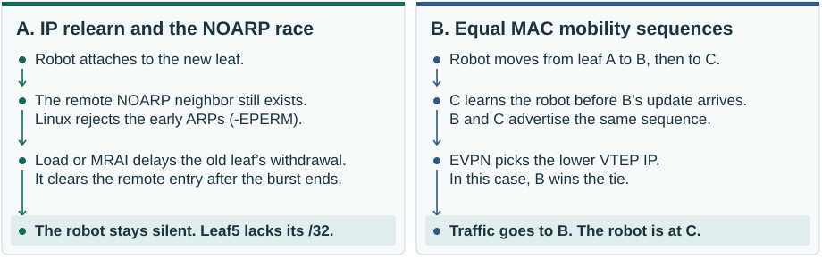
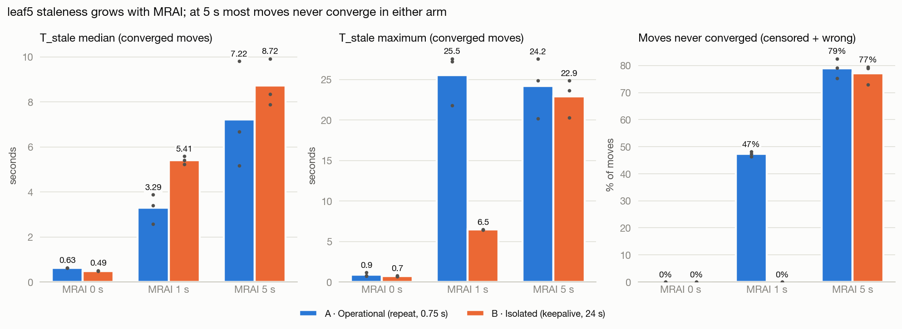
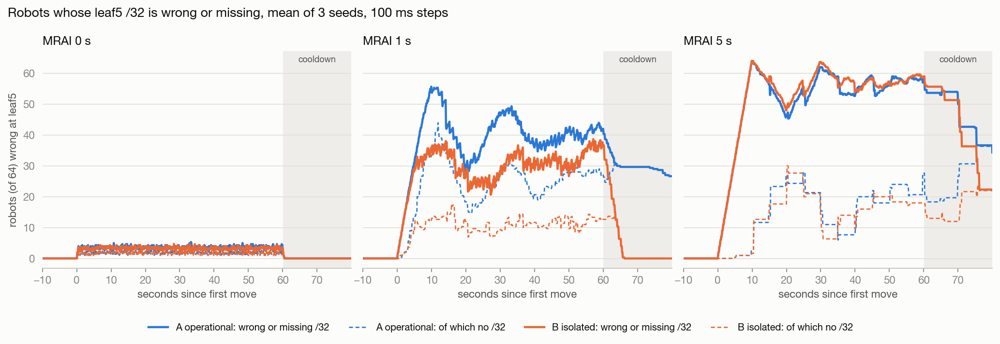
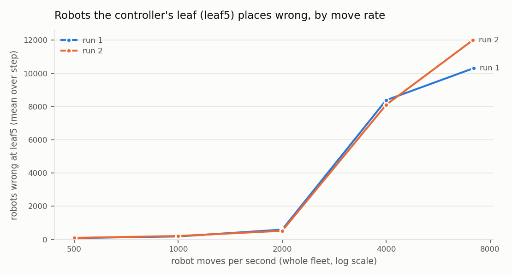
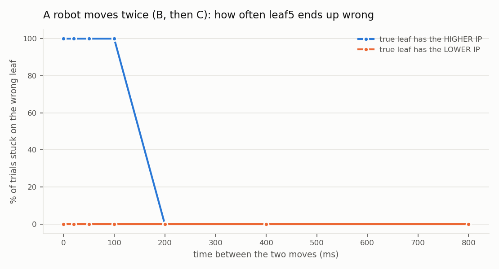
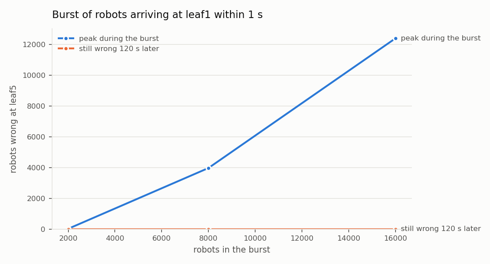
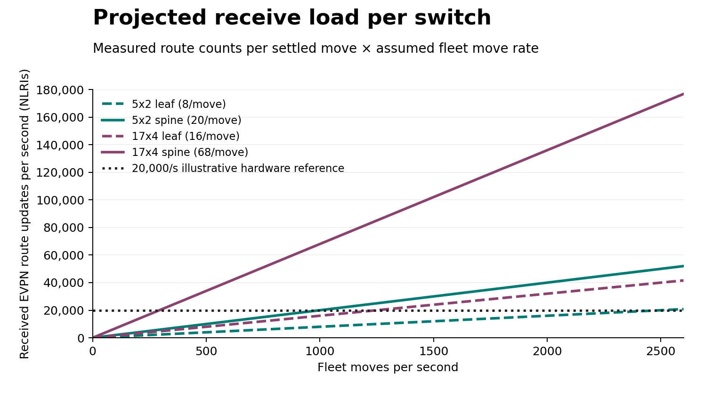

# When a warehouse robot moves faster than its route

**Cisco capstone | Team final report | Baseline study and Experiments 1 to 5**

> **Core Finding:** A robot is at risk whenever it moves again, or stops announcing its IP, before the fabric finishes converging on its previous location.
>
> **Program Evidence:** 120 baseline kernel-trace trials, 48 controlled wire-and-FIB trials across Experiments 1 to 3 (zero capture gaps), and Pradeep's Experiment 4 and 5 overload ramps and single-leaf arrival bursts.

## 1. Answers for Patrice

**What breaks?** A robot can attach successfully while the controller's leaf still sends its traffic to an old location or has no host route for it. We observed two ways to reach that state. A new leaf can miss the robot's IP announcement, or two leaves can claim its MAC with the same mobility sequence number.

| Sponsor question | Answer from the lab |
|---|---|
| Where does the first error appear? | At the new access leaf for IP relearning. For a sequence tie, two origin leaves disagree. The controller-facing symptom in both cases is a missing or incorrect /32. |
| Why can errors outlast the load? | The endpoint may be silent after its remote neighbor entry clears. A tie can also leave all switches in agreement on an old location. Empty queues resolve neither condition by themselves. |
| What scales with fabric size? | With the tested eBGP policy, a settled move costs four received route entries per opposite-tier neighbor on every switch. |
| What transfers to production? | The route-count model is conditional on topology and policy. The neighbor handling and tie rules can be checked in the target software. The laptop's timing, CPU cost and overload rate need hardware measurements. |

**How we tested.** The baseline used Linux neighbor traces. Guna's Experiments 1 to 3 compared decoded wire messages and individual EVPN routes with the installed forwarding table on an Apple M4 Colima VM. Pradeep's Experiments 4 and 5 used direct kernel injection on one Intel i5 laptop to drive higher rates. All used FRR EVPN and a five-leaf, two-spine baseline. Experiment 1 also varied fabric size.

**How to read the evidence.** *Measured* means a capture, trace or forwarding-table check recorded the outcome. *Source-code-supported* identifies behavior in the tested implementation. *Inferred* identifies our explanation where the measurements stop short of tracing cause. *Untested* identifies a projection or change that needs a separate trial.

## 2. Baseline study: why a robot can lose its IP route

**What we changed.** Across 120 trials, the team varied post-attach ARP behavior, handoff overlap and fleet movement. In the ordering tests, we followed one robot from its last frame at the old leaf to its first locally learned IP at the new leaf.

| Step | What the traces showed | Effect on the controller path |
|---|---|---|
| Attach | The new leaf learned the local MAC while it still held a remote IP neighbor marked NOARP. | A correct local MAC alone could not restore the /32. |
| Early ARP | All 124 robot ARPs that reached the new leaf while that neighbor existed were rejected. The kernel returned a permission error. | Sending a single announcement immediately could leave the IP unlearned. |
| Withdrawal | The old MAC/IP withdrawal cleared the remote entry. At idle the gap from MAC learn to removal was about 75 ms. | A subsequent ARP could now install the local binding. |
| Relearn | All 45 recovered runs in the 50 ordering tests learned the IP after removal. Five remained unrecovered in the observation window. | The new leaf could advertise the binding and restore the controller host route. |

**Measured.** The burst, delayed and ping patterns recovered in 30/30 ordering trials. In staggered 64-robot fleet roams, 124/320 moves were unrecovered at window end. Many fleet robots never sent a new ARP request. A missing /32 exposed a fallback through the shared subnet route that did not reliably reach the robot.

**Source-code-supported.** Linux protects the existing NOARP neighbor against this update. The kernel trace and withdrawal timing explain why changing the endpoint's announcement timing changed the result.

**Limit.** A different network OS, kernel or endpoint can handle relearning differently. The 75 ms gap is a lab observation. It does not specify how long a production robot should retry.

**Evidence:** [Baseline measurements and kernel traces](../roadmap360/REPORT_360_FINDINGS.md).

## 3. Experiment 1: a settled move has a predictable route cost

We moved one robot only after the fabric agreed on its previous location for two seconds. We changed the topology from 5, 9 or 17 leaves to either two or four spines, with three seeds per combination. We captured all leaf-spine links and reconciled BGP messages with the switch counters.

**Plotted.** Received route entries per switch and settled move, by topology. Bars show measurements and ticks show predictions. 
**Numbers.** Each leaf received 4S entries and each spine received 4L, with agreement across all six topologies. 
**Warehouse impact.** Adding access leaves increases the load on every spine even when each existing leaf receives the same number of entries.

| Per completed move | 5x2 | 17x4 | Measured relationship |
|---|---:|---:|---|
| Route entries received by one leaf | 8 | 16 | 4 x number of spines |
| Route entries received by one spine | 20 | 68 | 4 x number of leaves |
| Directed route transmissions across fabric | 80 | 544 | 8 x leaves x spines |

**Measured.** All 108 moves across 18 trials matched the formulas, with zero capture gaps. The new leaf advertised the MAC and MAC/IP binding and the old leaf withdrew both. A route copied across a second link counted again. Of 26,784 transmissions, half were echoes to the originating leaf or leaf re-advertisements toward spines.

**Limit.** These are counts of EVPN route entries (NLRIs). An UPDATE message can carry multiple entries, and a switch can reject a received route. The formulas describe the tested propagation policy and fully propagated changes. They do not measure switch capacity.

**Evidence:** [Experiment 1 findings](experiment1/EXPERIMENT1_FINDINGS.md) and [trial CSV](experiment1/results.csv).

## 4. Experiment 2: simultaneous roams pack more routes per message

We paired synchronized and staggered schedules for 64 robots with the same destinations and seed. Each of the 12 trials had 384 moves. Three pairs used 10 s dwell and three used 30 s dwell. The route counter decoded BGP messages on each session. A separate monitor checked whether the controller leaf selected the expected tunnel endpoint.

**Plotted.** Decoded BGP messages and Type-2 route entries in synchronized and staggered trials. 
**Numbers.** Grouped moves used about 5,000 messages per trial and staggered moves about 23,000 for roughly 30,880 entries. 
**Warehouse impact.** Warehouse shift changes can pack routes efficiently while concentrating arrivals into short bursts.

| Dwell | Mean UPDATEs, grouped / staggered | Mean Type-2 NLRIs, grouped / staggered | Mean NLRIs/UPDATE, grouped / staggered |
|---|---:|---:|---:|
| 10 s | 4,939 / 22,901 | 30,880 / 30,880 | 6.26 / 1.35 |
| 30 s | 5,251 / 23,091 | 30,880 / 30,827 | 5.91 / 1.34 |

**Measured.** Grouping cut wire UPDATE messages by 75.1-79.1% across the six pairs. Robot-specific route volume stayed at 30,720 per trial. The small difference in total Type-2 volume came from non-robot withdrawals outside one movement window. The monitor saw the correct next hop after all 4,608 attachments. All 768 endpoint checks passed at the end.

**Interpretation and limit.** More routes shared each BGP message. Both daemons used fewer sampled CPU seconds in each grouped pair. Grouping also concentrates arrivals. Short peaks can fall between CPU samples, and this experiment did not establish a safe warehouse burst size.

**Evidence:** [Experiment 2 findings](experiment2/EXPERIMENT2_FINDINGS.md) and [trial CSV](experiment2/results_exp2.csv).

## 5. Experiment 3: delayed advertisements can hide entire visits

We tested MRAI values of 0, 1 and 5 s on all seven routers at 6.4 moves/s, with 64 robots and 10 s dwell. Three seeds per setting and endpoint behavior gave 18 trials. **Arm A** used four gateway pings over 0.75 s after attach, exposing the timer's interaction with NOARP. **Arm B** used 24 s of 4 Hz gateway traffic to isolate timer delay.

| Measurement | MRAI 0 s | MRAI 1 s | MRAI 5 s |
|---|---:|---:|---:|
| Arm A UPDATEs/move | 59.4 | 25.5 | 7.2 |
| Arm B UPDATEs/move | 59.6 | 23.2 | 7.7 |
| Arm A: New leaf announced MAC/IP during visit (of 384), mean | 384 | 203 | 152 |
| Moves censored or wrong at deadline, A / B | 0% / 0% | 47.3% / 0% | 79.0% / 77.1% |
| Correct after quiescence (of 64), A / B | 64 / 64 | 36-45 / 64 | 31-42 / 64 |

**Plotted.** Time to a stable correct /32 for converged moves, followed by the share missing their observation deadline. 
**Numbers.** At 1 s, Arm B median delay averaged 5.41 s. At 5 s, 77.1% of Arm B moves missed their deadline. 
**Warehouse impact.** Compare convergence with the time a robot stays at one leaf to see how much of its visit the controller can use.

**Plotted.** Mean number of robots with a wrong or missing /32 on leaf5, sampled every 100 ms during movement and cooldown. 
**Numbers.** At MRAI 5 s, Arm B averaged 59 wrong routes when movement stopped and 22.3 after the 20 s cooldown. All 64 were correct at quiescence. 
**Warehouse impact.** A check after the shift ends can pass even when the controller missed robots during their visits.

- **Measured, Arm A.** At 1 s the new leaf advertised the MAC/IP during only 203 of 384 visits per trial on average. The short burst could end before the withdrawal cleared the remote neighbor. Mean trial maximum T_stale was 25.5 s. The largest individual value was 27.6 s.
- **Measured, Arm B.** At 1 s every move converged, but mean trial median T_stale rose from 0.49 to 5.41 s. At 5 s, 821 moves were overtaken by the next roam (85.5% of the 960 nonfinal moves). Another 67 final visits were still wrong at the 20 s cooldown deadline. Together these give 888 of 1,152 moves (77.1%). All three seeds later reached 64/64 at quiescence.
- **Source-code-supported.** FRR's per-peer timer can delay both announcements and withdrawals. Several paced hops separate a robot's first local frame from a usable controller /32. At 5 s we measured ties in both arms, even at this modest move rate. None appeared at 0 or 1 s.
- **Limit.** T_stale covers only visits that achieved a stable correct route during observation. Continued traffic and final recovery do not establish how each tie healed.

**Evidence:** [Experiment 3 findings](experiment3/EXPERIMENT3_FINDINGS.md), [trial CSV](experiment3/results_exp3.csv) and [timer code review](experiment3/EXPERIMENT3_PLAN.md).

## 6. Experiment 4: repeat movement under backlog

Pradeep spread 16,000 robots across the fabric and raised offered load in 30 s steps from 500 to 8,000 moves/s. Two runs used different random seeds. Injection wrote the MAC and IP directly into the new leaf. This bypassed the NOARP relearn gap. The injected robots sent no follow-up traffic.

**Plotted.** Mean robots whose controller-leaf route disagreed with their attachment at each ramp step, for both runs. 
**Numbers.** At 2,000 moves/s, 521-593 robots were wrong on average. At 4,000 moves/s that rose to 8,108-8,387. 
**Warehouse impact.** Compare revisit time with propagation delay under load. The laptop rate itself gives no hardware switch rating.

| Delivered moves/s | Mean robots wrong, run 1 / run 2 | RX routes per move, spine / leaf |
|---|---:|---:|
| 500 | 86 / 93 | 20 / 8 |
| 1,000 | 181 / 210 | 20 / 8 |
| 2,000 | 593 / 521 | 20 / 8 |
| 4,000 | 8,387 / 8,108 | 12.3 / 5.0 |
| 7,100-7,200 | 10,316 / 12,009 | 6.2 / 2.6 |

**Measured.** Queues drained and CPUs went idle within 20 s of stopping movement. At the end of 120 s of rest, 7,195 and 9,327 robots still pointed to the wrong leaf. The runs recorded no wire packet drops, BGP session resets or daemon failures. TCP did record 154-157 retransmissions per ramp.

**Inferred.** Intermediate changes being superseded during backlog fits the falling routes per move. The abrupt jump near 4,000 moves/s belongs to a laptop emulating all seven switches. The runs do not give a Cisco switch capacity or a permanent outage duration for active endpoints.

**Evidence:** [Pradeep's ramp measurements](reference/nov_17_pradeep_RESULTS.md).

## 7. Experiment 4 control: one robot reproduces the sequence tie

We can separate the race from high CPU load. On an otherwise idle fabric, Pradeep moved one robot from A to B, then B to C, and varied the gap between moves and the ordering of the B and C tunnel endpoint IPs. Five runs at each point checked which leaf won.

**Plotted.** Stuck trials by time between two moves, split by the IP ordering of the last two leaves. 
**Numbers.** At gaps up to 100 ms, 20/20 stuck when the true leaf had the higher IP and 0/20 when it had the lower IP. 
**Warehouse impact.** A fast second handoff can leave an idle fabric forwarding to the wrong access leaf.

**Source-code-supported.** When a MAC becomes local, zebra uses the last remote mobility sequence to advance the local sequence. If C has not heard B's update, both can advertise the same number. FRR's EVPN selection then favors the lower tunnel endpoint IP. It can select B even when the robot is at C. [Local sequence selection](../../../../zebra/zebra_evpn_mac.c) and [EVPN path selection](../../../../bgpd/bgp_route.c).

**Measured.** One stuck trial recorded the true leaf holding local and remote sequence 2 and selecting the remote owner. Among ramp cases stuck on the previous leaf, that leaf had the lower IP in 4,506 of 5,341 cases.

**Limit.** The controlled race identifies one failure mechanism. It does not attribute every missing /32 or every older-leaf result in the ramp to a tie. The measured 100-200 ms transition depends on propagation time on this host. In production the useful comparison is each robot's revisit interval against the time its previous move takes to spread.

**Evidence:** [Race test and ramp case counts](reference/nov_17_pradeep_RESULTS.md).

## 8. Experiment 5: many arrivals, one move per robot

Pradeep sent 2,000, 8,000 or 16,000 injected robots to leaf1 within one second. Unlike the ramp, each robot moved only once during the burst. We compared the attachment list with leaf5's /32s during the burst and again after 120 s of rest.

**Plotted.** Peak sampled wrong routes and routes still wrong 120 s later, by burst size. 
**Numbers.** The largest burst peaked near 12,400 wrong routes and returned to all correct in 4.7 s. 
**Warehouse impact.** A fleet can recover from one mass arrival while still losing a useful controller path for several seconds.

| Robots arriving | Peak sampled wrong at leaf5 | All routes correct again | Wrong after 120 s |
|---|---:|---:|---:|
| 2,000 | 20 | 2.0 s | 0 |
| 8,000 | About 4,000 | 3.4 s | 0 |
| 16,000 | About 12,400 | 4.7 s | 0 |

**Measured.** Even the largest single burst recovered. It still left thousands of transiently stale routes. Across these two experiments, moving the same endpoint again before its prior update spread produced a different outcome from moving many endpoints once.

**Limit.** Sampling every 1-2 s can miss short peaks, especially at 2,000 arrivals. These three burst sizes on one host do not establish an acceptable interruption for robot control traffic.

**Evidence:** [Pradeep's burst measurements](reference/nov_17_pradeep_RESULTS.md).

## 9. What transfers to a real switch

Use the Experiment 1 slopes to estimate received route work before choosing hardware test loads. Multiply fleet moves/s by received entries per move for one switch. This assumes every move propagates fully under the measured eBGP policy. It leaves out CPU scheduling, message packing, filtering and queue service time.

**Plotted.** Projected EVPN route entries received per second by one leaf or spine, versus fleet move rate. 
**Numbers.** At 1,000 moves/s the two spine estimates are 20,000/s and 68,000/s. The dotted 20,000/s reference is illustrative. 
**Warehouse impact.** Use the slopes to select hardware test loads and measure how long the controller route stays stale at each load.

| At 1,000 fleet moves/s | One leaf | One spine |
|---|---:|---:|
| 5x2 | 8,000 received NLRIs/s | 20,000 received NLRIs/s |
| 17x4 | 16,000 received NLRIs/s | 68,000 received NLRIs/s |

**Untested on hardware.** The 20,000/s line is an illustrative reference. On 17x4 a spine reaches that arithmetic reference at about 294 moves/s. Crossing it predicts neither loss nor a queue. Experiment 4 shows why extrapolation needs care: once moves overlapped under load, observed route entries per move fell even while forwarding got worse.

**What to carry over.** Measure the actual route policy, route count, minimum revisit interval and time to a stable controller /32 on the target fabric. Check the target NOS's neighbor and equal-sequence behavior. CPU percentages, ARP timing, the 4,000 moves/s jump and the 4.7 s recovery time all belong to the lab platforms.

**Evidence:** [Experiment 1 route counts](experiment1/results.csv) and [Pradeep's ramp measurements](reference/nov_17_pradeep_RESULTS.md).

## 10. Priorities for Cisco

### Operational practices supported by measurements

| Priority | Action | Acceptance check on the target fabric |
|---|---|---|
| 1 | Start evaluation at MRAI 0 on the mobility peers. The 1 s timer already consumed about half a 10 s dwell in Arm B. | Compare actual attachment with the installed controller /32 throughout each visit. Count both deadline misses and eventual recovery. |
| 2 | Verify that the robot generates ARP traffic after the old remote binding clears. The baseline's retried or delayed patterns recovered in 30/30 ordering trials. | Capture the withdrawal, the first accepted local ARP and the first correct /32. Size the retry window from the target fabric. |
| 3 | Budget for peak arrival rates by switch role. Observe both grouped arrivals and rapid repeat moves by one robot. | Record UPDATE messages, route entries, queue depth and wrong-leaf duration together. A lower message rate alone cannot certify forwarding. |

### Untested FRR changes to investigate

1. **Probe for the IP after withdrawal.** When a remote IP binding clears and the MAC is still local, test whether zebra can solicit a fresh neighbor response. Check silent endpoints, duplicate bindings and probe volume. We have no trial of this change.
2. **Recheck local ownership after an equal-sequence loss.** Investigate whether a leaf with fresh local evidence could safely re-originate with a higher sequence. Review EVPN interoperability and test for oscillation between leaves before considering deployment. The race control demonstrated the failure, not this repair.

**Separate configuration question.** Sender-side AS-path loop detection is worth testing against the measured 50% echo and re-advertisement share. We did not test it under mobility or measure a change in capacity. The next hardware comparison should use endpoint traffic as well as injection so it can expose both NOARP relearning and repeated-move races.

**Evidence boundary.** Experiments 1 to 3 have committed per-trial counts and findings. The baseline has its own trace report. For Experiments 4 and 5 we used Pradeep's committed handoff copy and its figures. The ramp and burst raw CSVs are outside that handoff.

**Evidence:** [Individual technical report](REPORT_EXP1_TO_3.md) and [Pradeep's evidence handoff](reference/nov_17_pradeep_RESULTS.md).
