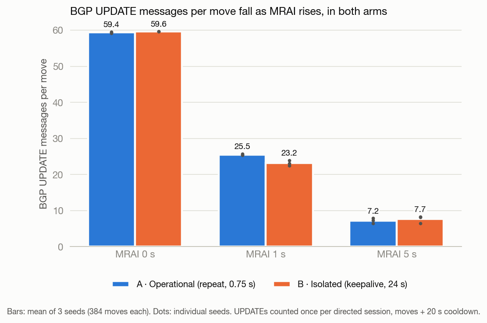
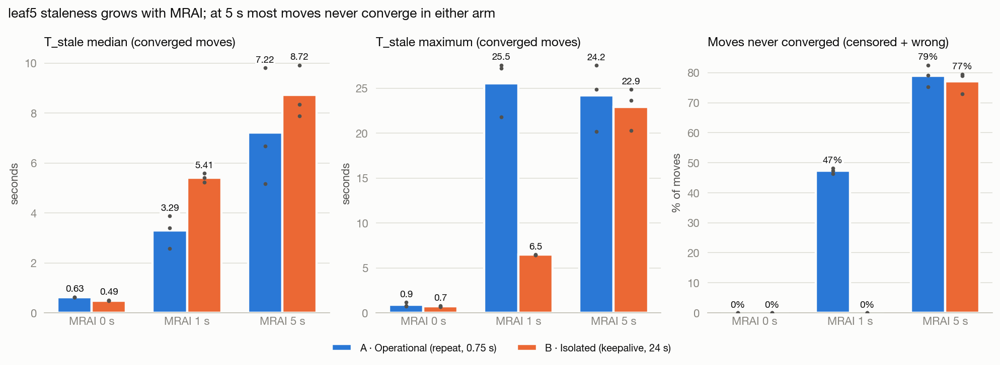
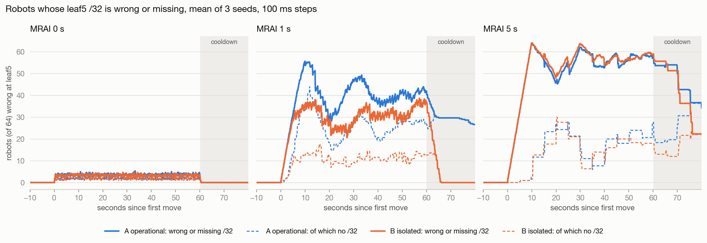

# What one robot roam costs the fabric

**Cisco capstone | Guna's individual technical report | Experiments 1 to 3**

## 1. Problem and experimental setup

A robot can reach its new access point while the warehouse controller still sends traffic to its old leaf. We tracked the robot's attachment, the routes exchanged by the switches, and the route the controller's leaf actually installed. Each answers a different question.

| Experiment | What we changed | What we measured | Main observation |
|---|---|---|---|
| 1. Fabric size | Leaves and spines, one settled roam at a time | Routes received per switch | 8 to 68 per move, depending on role and size |
| 2. Group timing | Same robot paths, grouped or spread out in time | Messages, routes per message, installed paths | Grouping cut messages by 75-79% |
| 3. Advertisement interval | 0, 1 or 5 s with short or sustained endpoint traffic | Messages and time on a stale path | A quieter wire could hide a missing robot route |

**Lab.** We ran FRR 10.8.0-dev with eBGP EVPN in a Colima Linux VM on an Apple M4, with six vCPUs and 8 GiB RAM. The baseline had five leaves and two spines. The controller sat behind the last leaf (leaf5 on 5x2). Robots kept their MAC and IP through break-before-make moves. Duplicate address detection was disabled.

**Counting rule.** We used the route_counter capture methodology on every leaf-spine link. We reassembled TCP, decoded BGP UPDATE messages, then counted the EVPN route entries (NLRIs) inside each message. Each advertisement or withdrawal on one directed session counted once. One message can carry several entries. One entry can cross several sessions.

**Checks.** We reconciled message counts against FRR counters. All 48 accepted trials had zero capture gaps. Separately, we compared the robot's true attachment with the next hop in the controller leaf's installed /32 host route. A wire count alone cannot tell us where a controller packet will go.

## 2. Fabric size sets the route work per move

We varied leaves (L) and spines (S) independently. Each of three seeds drove six moves per topology. Before the next move, we required local MAC ownership, remote leaf agreement, and the correct controller /32 to hold for two seconds.

| Leaves x spines | RX per leaf | RX per spine | Fabric NLRI transmissions | Fabric BGP UPDATEs |
|---|---:|---:|---:|---:|
| 5x2 | 8 | 20 | 80 | 60 |
| 9x2 | 8 | 36 | 144 | 108 |
| 17x2 | 8 | 68 | 272 | 204 |
| 5x4 | 16 | 20 | 160 | 120 |
| 9x4 | 16 | 36 | 288 | 216 |
| 17x4 | 16 | 68 | 544 | 408 |

**Plotted.** Received route entries per switch and settled move, by topology. Bars show measurements and ticks show predictions. 
**Numbers.** Each leaf received 4S entries and each spine received 4L, with agreement across all six topologies. 
**Warehouse impact.** Adding access leaves increases the load on every spine even when each existing leaf receives the same number of entries.

**Measured.** All 108 moves matched the formulas. The new leaf announced a MAC route and a MAC/IP route. The old leaf withdrew both. Of 26,784 route transmissions, 1,296 were echoes to the origin and 12,096 were leaf re-advertisements. Together these made up exactly 50%.

**Scope.** The formulas describe settled moves under this propagation policy. An isolated move does not measure sustainable throughput, CPU headroom or convergence under concurrent load. [Experiment 1 findings](experiment1/EXPERIMENT1_FINDINGS.md) and [18 trial records](experiment1/results.csv).

## 3. Grouping moves changes the BGP message count

We moved 64 robots six times each on 5x2. Each matched pair used the same seed, placements, and destinations. We changed when robots moved within a round. Three pairs used 10 s dwell and three used 30 s dwell.

| Dwell | Schedule | Mean UPDATEs/trial | Mean Type-2 NLRIs/trial | Mean NLRIs/UPDATE |
|---|---|---:|---:|---:|
| 10 s | Synchronized | 4,939 | 30,880 | 6.26 |
| 10 s | Staggered | 22,901 | 30,880 | 1.35 |
| 30 s | Synchronized | 5,251 | 30,880 | 5.91 |
| 30 s | Staggered | 23,091 | 30,827 | 1.34 |

**Plotted.** Decoded BGP messages and Type-2 route entries in synchronized and staggered trials. 
**Numbers.** Grouped moves used about 5,000 messages per trial and staggered moves about 23,000 for roughly 30,880 entries. 
**Warehouse impact.** Warehouse shift changes can pack routes efficiently while concentrating arrivals into short bursts.

**Measured.** Each trial carried exactly 30,720 robot Type-2 entries (80 per move). One staggered run placed 160 non-robot withdrawals in the quiet window, explaining the small difference in all-Type-2 totals. Across six pairs, UPDATE messages fell 75.1-79.1%. Both bgpd and zebra used fewer sampled CPU seconds in every synchronized pair.

**Forwarding check.** The route monitor saw the correct tunnel endpoint after all 4,608 attachments. At the final check, 768/768 robot routes selected the expected next hop across 12 trials.

**Limit.** Grouping can concentrate arrivals at one instant. A one-second CPU sample can miss a short spike. These runs establish message packing and eventual path correctness at this scale. They do not establish a safe burst size or equal delay for the two schedules. [Experiment 2 findings](experiment2/EXPERIMENT2_FINDINGS.md) and [12 trial records](experiment2/results_exp2.csv).

## 4. Advertisement interval and the short ARP burst

We set the minimum route advertisement interval (MRAI) on all seven switches to 0, 1 or 5 s. Both arms used the same staggered 64-robot schedule, 10 s dwell, 384 moves per trial and three seeds per setting. We counted UPDATEs during movement and the next 20 s, then checked the installed routes again after BGP went quiet.

**Arm A, short announcements.** After each attach the robot sent four gateway pings over 0.75 s to trigger ARP learning. This arm measures the combined effect of MRAI and the new leaf's existing remote NOARP neighbor entry. The baseline kernel traces show that an early ARP can be rejected until the old binding is withdrawn.

**Plotted.** Wire UPDATEs per move during movement and the fixed cooldown, by timer and endpoint behavior. 
**Numbers.** At 5 s, Arm A fell from 59.4 to 7.2 messages per move and Arm B from 59.6 to 7.7. 
**Warehouse impact.** A quieter BGP session can coincide with a controller sending packets to the wrong rack.

| Arm A, mean over three seeds unless a range is shown | 0 s | 1 s | 5 s |
|---|---:|---:|---:|
| UPDATEs per move | 59.4 | 25.5 | 7.2 |
| New leaf announced MAC/IP during visit, of 384 | 384 | 203 | 152 |
| Moves censored or wrong at cooldown end | 0% | 47.3% | 79.0% |
| Correct /32s after quiescence, range out of 64 | 64 | 36-45 | 31-42 |

**What failed.** At 1 s, the new leaf announced a MAC route during every visit, but missed the MAC/IP announcement during about 181 visits per trial. Without that binding, the controller leaf lacked a reliable /32 to the robot. A reduced NLRI count can therefore mean missing locations.

**Source-code-supported.** FRR's per-peer advertisement timer gates packet generation for withdrawals as well as announcements. The new MAC advertisement must travel via a spine to the old leaf, then the withdrawal must travel back. **Inferred.** A flooded ARP from the next attach could explain late IP announcements by a leaf the robot had left. We did not trace that ARP.

## 5. Sustained traffic isolates the timer cost

**Arm B, keepalive.** We extended gateway traffic to 24 s at 4 Hz so the robot could still trigger IP relearning after a delayed withdrawal. At 1 s MRAI every move converged, exposing the delay even when IP relearning succeeded. At 5 s the timer and the 10 s dwell overlapped.

**Plotted.** Time to a stable correct /32 for converged moves, followed by the share missing their observation deadline. 
**Numbers.** At 1 s, Arm B median delay averaged 5.41 s. At 5 s, 77.1% of Arm B moves missed their deadline. 
**Warehouse impact.** Compare convergence with the time a robot stays at one leaf to see how much of its visit the controller can use.

We measured T_stale from attachment until the /32 selected only the new tunnel endpoint and stayed correct for the rest of the observation window. Timing summaries include only converged moves. In Arm A at 1 s, **25.5 s** is the mean of three trial maxima. The longest individual observation was **27.6 s**.

**Plotted.** Mean number of robots on a wrong or missing controller route during movement and cooldown, sampled at 100 ms. 
**Numbers.** At 5 s, Arm B averaged 59 wrong routes when movement ended and 22.3 at cooldown end. 
**Warehouse impact.** Sampling only after the fabric settles misses the interval when controllers still need to reach moving robots.

**Read the 77% carefully.** At 5 s in Arm B, 821 moves were overtaken by the next roam (85.5% of the 960 nonfinal moves). Another 67 final moves had no stable correct route by the 20 s cooldown deadline. Together they account for 888/1,152 (77.1%). In the three seeds, 29, 19 and 19 robots were still wrong at that deadline. All three later reached 64/64 after quiescence.

## 6. Key findings and limits

| Question for the operator | What we can say from the lab |
|---|---|
| How much route work should a settled move generate? | Each leaf received 4S route entries, each spine 4L. Sum switch receives to get 8LS transmissions without double counting. |
| Can we judge load from packet count? | Count both UPDATE messages and route entries. Group timing packed the same robot routes into fewer messages. Delaying advertisements also cut messages, but could hide a visit entirely. |
| When did the timer alone matter? | With sustained traffic, mean trial median T_stale rose from 0.49 s to 5.41 s at MRAI 1 s. At 5 s even sustained traffic could not keep up with most visits. |
| What should we watch at handoff? | Compare attachment truth with the installed controller /32 during movement. A final correct snapshot missed long periods of stale forwarding. |

**Measured.** At 5 s, captures across three seeds recorded 9 MAC and 3 MAC/IP sequence ties in Arm A, and 11 MAC and 4 MAC/IP ties in Arm B. Neither arm had a tie at 0 or 1 s. Equal sequence numbers mean two leaves claimed the same mobility sequence for the same robot route.

**Inferred.** Delayed propagation let a second leaf originate a move before it learned the prior sequence. The ties document competing claims. The final FIB check does not identify which packet or sequence change repaired each robot.

**Untested.** Per-neighbor timer changes on just the spines, a production switch's processing rate, and a production robot's ARP behavior remain open. The 24 s stream was an experimental control. A deployment needs its own measurements of minimum dwell and the time from a roam to a stable /32.

[Experiment 3 findings](experiment3/EXPERIMENT3_FINDINGS.md), [18 trial records](experiment3/results_exp3.csv), [timer code review](experiment3/EXPERIMENT3_PLAN.md) and [baseline neighbor traces](../roadmap360/REPORT_360_FINDINGS.md).
