# Experiments 4 and 5: what happens when robots move faster than the fabric can keep up

*Pradeep's half of the plan. Runs of November 16–17, 2026, on the unchanged capstone fabric (2 spines, 5 leaves, FRR 10.8.0-dev).*

## 1. Summary

- **The fabric breaks at about 4,000 robot moves per second on this laptop.** Below that, leaf5 (the controller's leaf) is right about 0.2 s after each move. Above it, half of the robots are on the wrong leaf at any moment.
- **The break is permanent, not just slow.** When the load stopped, every queue emptied and every CPU went idle within 20 s. But **7,195 and 9,327 of 16,000 robots stayed on the wrong leaf** (two runs) for the whole 2-minute rest.
- **Cause: a tie in the MAC-mobility sequence number.**
  1. During a backlog, a robot moves again before its previous move has reached every leaf.
  2. The new leaf then picks the **same** sequence number as the previous leaf.
  3. EVPN breaks the tie with "**lower IP wins**", so the fabric picks the wrong leaf.
- **Proven at zero load** with one robot moving twice: whenever the second move came within 100 ms of the first (before the update had spread) and the true leaf had the higher IP, **20 of 20 trials** ended stuck on the wrong leaf.
- **Sheer volume alone does not break it.** 16,000 robots arriving at one leaf within 1 s recovered fully in 4.7 s, with nothing stuck.
- **Nothing was lost on the wire:** no BGP session reset, no process died, no TCP drops or zero-windows. The protocol did exactly what it was designed to do, and reached the wrong answer.

## 2. How we drove the load (and what that changes)

The earlier experiments were capped at about 120 moves/s by the cost of emulating real robots. To go far beyond that, a new tool (`mobility_inject.py`) creates moves directly on the leaves. A move writes into the new leaf's kernel the two facts it would learn from a real robot:
- the robot's MAC on the access-point port
- the robot's IP-to-MAC binding

zebra and BGP then react exactly as for a real robot. We checked this layer by layer: local sequence +1 on the new leaf, remote everywhere else, leaf5's /32 moved to the new leaf.

| Deliberate difference from real robots | Effect on the results |
|---|---|
| The IP is written directly | The known "IP not relearned" bug (earlier reports) is **bypassed**, so these results are about load only |
| Robots never send traffic afterwards | A robot that loses a tie is **never re-learned**. A real robot's next packet would usually trigger a new move with a higher sequence. See section 6. |
| Moves are chosen at random; a robot moves again only after at least 2 s | Each robot moves every 2–4 s on average at the highest rates |

**What we measured** (every second, on every switch):
- **Robots wrong:** how many robots each leaf's MAC table and leaf5's routing table place differently from where they really are. No pings needed.
- **Route updates received** per switch (packet captures, counting routes inside each BGP message).
- **Queues:** BGP in/out, zebra work queues, socket queues; plus TCP counters (retransmissions, zero-window, drops), CPU, and whether each daemon is alive.

## 3. Experiment 4: overload ramp

16,000 robots; move rate stepped 500 → 1,000 → 2,000 → 4,000 → 8,000 per second (30 s each), then 120 s with no moves. Two runs with different random seeds.

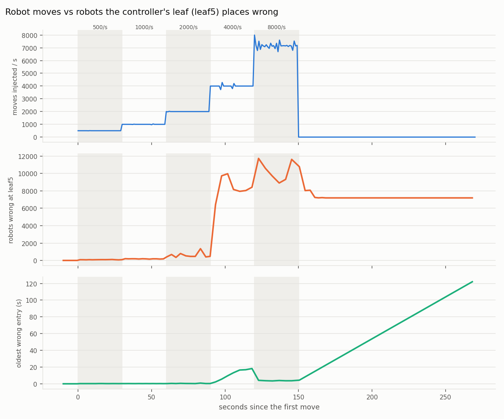

*Top: moves injected per second. Middle: robots leaf5 places wrong. Bottom: how long the oldest wrong entry has been wrong. Up to 2,000/s the wrong count stays near zero. At 4,000/s it jumps to about 10,000. After the moves stop, it flattens at about 7,200 and never comes back, while the oldest wrong entry keeps ageing.*

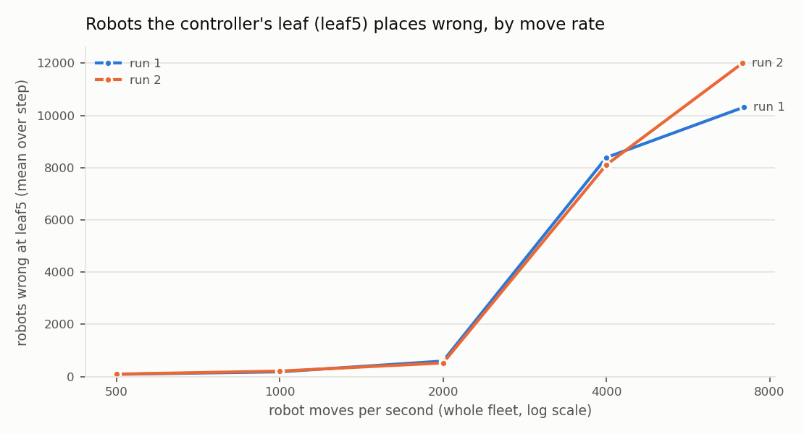

| Moves/s (delivered) | Robots wrong at leaf5 (mean, run 1 / run 2) | Time until leaf5 is right (s, Little's law) | Route updates received per move (spine / leaf) |
|---|---|---|---|
| 500 | 86 / 93 | 0.17 / 0.19 | 20 / 8 |
| 1,000 | 181 / 210 | 0.18 / 0.21 | 20 / 8 |
| 2,000 | 593 / 521 | 0.30 / 0.26 | 20 / 8 |
| **4,000** | **8,387 / 8,108** | **2.1 / 2.0** | 12.3 / 5.0 |
| 7,100–7,200 (8,000 offered) | 10,316 / 12,009 | 1.4 / 1.7 | 6.2 / 2.6 |

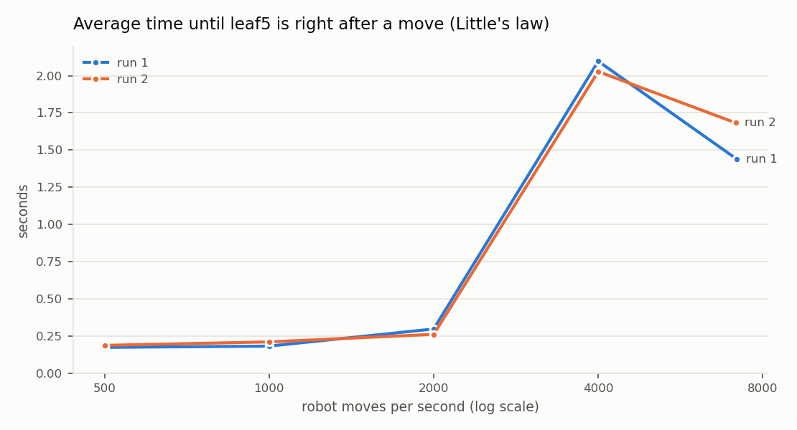

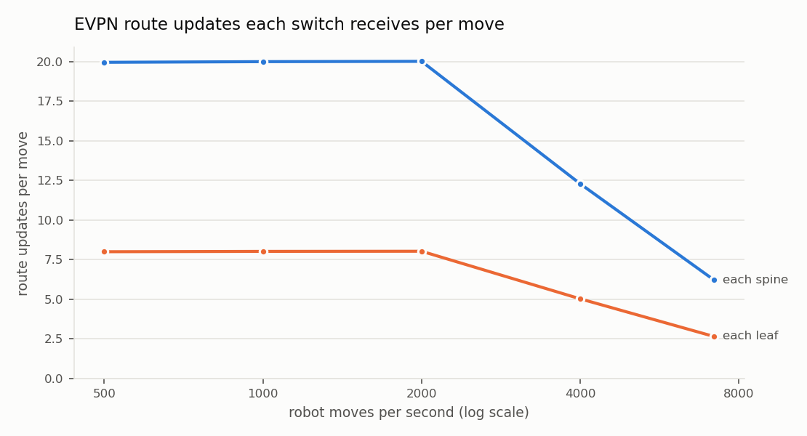

*Up to 2,000 moves/s, every move costs exactly **20 route updates at each spine and 8 at each leaf**, the formula from experiment 1 (spine = 4 × leaves, leaf = 4 × spines). Under overload the number falls, because BGP keeps only the newest state of each route and **skips** updates that are already outdated before they are sent.*

Queues and CPU over time (run 1):

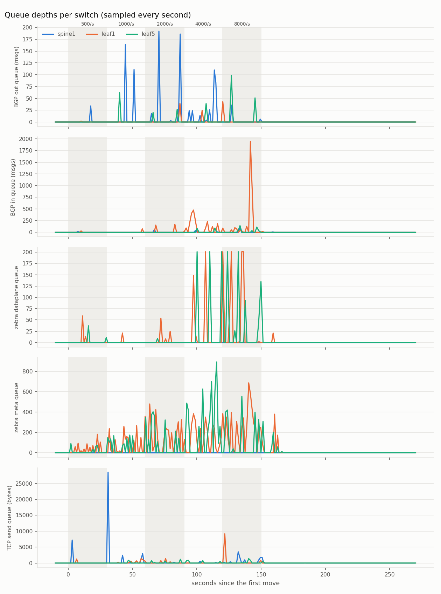
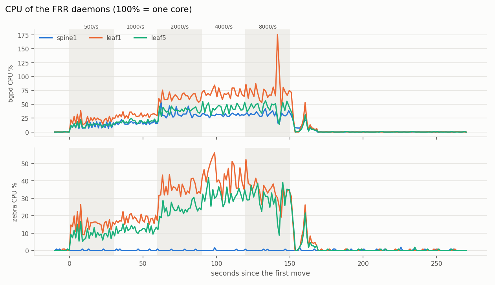

## 4. Why robots stay wrong: the sequence-number tie

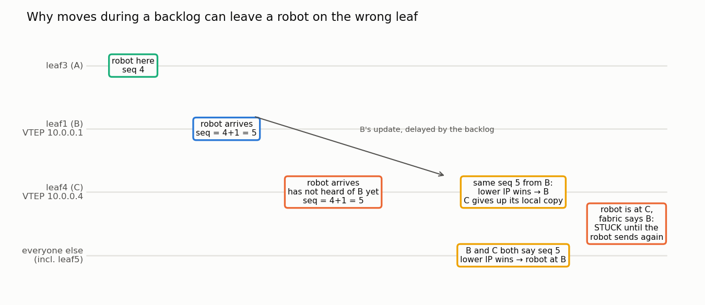

1. Each leaf numbers a robot's arrival as **the sequence it last heard + 1** (`zebra/zebra_evpn_mac.c`, line 2286).
2. Under a backlog, leaf C learns the robot **before** hearing that it arrived at B, so B and C both claim the same number.
3. BGP breaks the tie by **lower VTEP IP** (`bgpd/bgp_route.c`, line 1230: *"wins … due to same MM seq … and lower IP"*), so every switch, including C itself, decides the robot is at B.
4. Nothing else changes afterwards, so the wrong answer is permanent.

**Evidence in the ramp data.** Robots stuck on their *previous* leaf were stuck there because that leaf had the **lower** IP in 4,506 of 5,341 cases (84%; chance would give 50%).

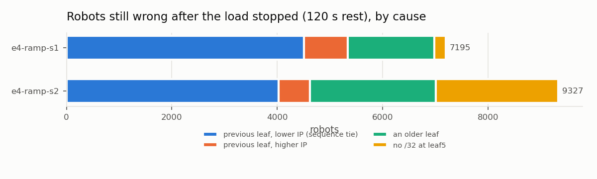

*Most stuck robots are explained by the tie. The rest (an older leaf, or no /32 at all) appear to be longer chains of the same race during the backlog; not analyzed in detail yet.*

**Proof at zero load (race test).** One robot moves A → B, then B → C after a controlled gap, with the fabric otherwise idle. 5 trials per point.

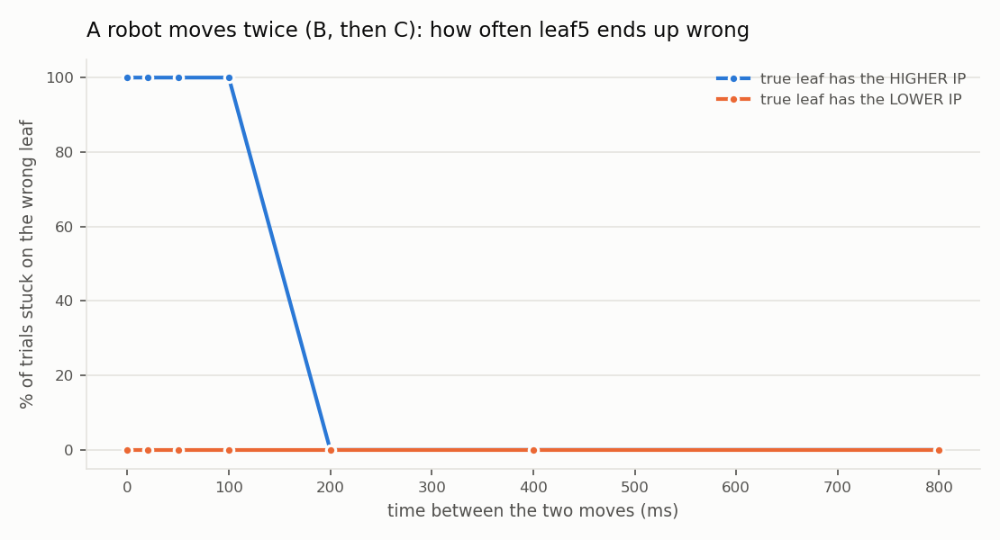

| Gap between the two moves | True leaf has the HIGHER IP | True leaf has the LOWER IP |
|---|---|---|
| 0–100 ms | **20 / 20 stuck** | 0 / 20 |
| 200–800 ms | 0 / 15 | 0 / 15 |

Example of a stuck trial, from zebra on the robot's true leaf (leaf4): `remote, local seq 2, remote seq 2, at 10.0.0.1`. The **same sequence number** from both leaves, and leaf1 won on IP.

**What transfers to real switches and what doesn't:**

| Result | Transfers? |
|---|---|
| The tie rule and how leaves pick sequence numbers | ✅ Protocol logic (RFC 7432, FRR code) |
| "A robot that moves twice within the fabric's convergence time can end up on the wrong leaf" | ✅ |
| The 100–200 ms window | ❌ Our idle convergence time on this laptop; real fabrics have their own |
| "Breaks at 4,000 moves/s" | ❌ Laptop speed. The *shape* (fine, then a sudden jump when the backlog exceeds the time robots stay put) transfers. |

## 5. Experiment 5: a burst of robots arriving at one leaf

16,000 robots spread over leaf2–leaf4; then 2,000, 8,000 or 16,000 of them move to leaf1 within 1 s.

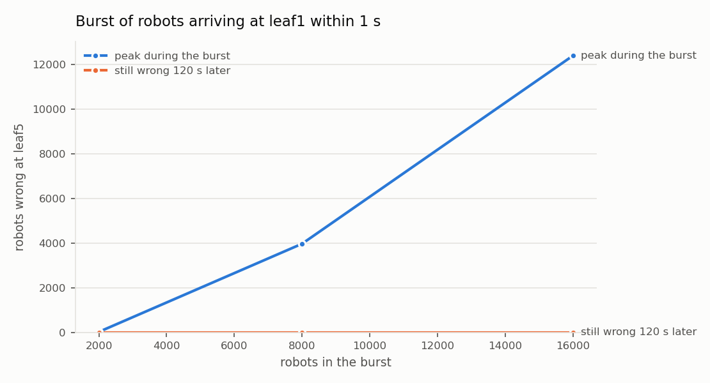
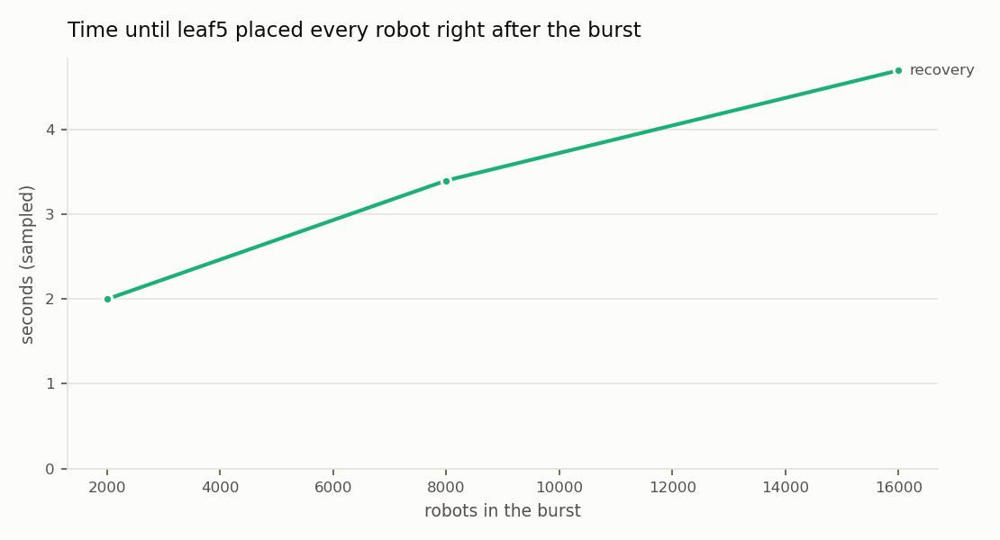

| Robots in the burst | Peak wrong at leaf5 | Back to all correct after | Still wrong 120 s later |
|---|---|---|---|
| 2,000 | 20 (sampled every ~2 s, so the peak was mostly missed) | 2.0 s | 0 |
| 8,000 | about 4,000 | 3.4 s | 0 |
| 16,000 | about 12,400 | 4.7 s | 0 |

**A single burst is handled.** Recovery grows with burst size, but nothing gets stuck. Each robot moves only once, so no robot can move again during the backlog, and no tie can happen. **What breaks the fabric is not the number of updates, but robots moving again before the previous update has spread.**

## 6. What this means for the warehouse

- A robot is at risk whenever it **moves again sooner than the fabric converges**. On an idle fabric that's a fraction of a second, but under load it's seconds. More robots and more moves → longer convergence → more robots at risk. That's the feedback loop behind the jump at 4,000/s.
- **Whether a stuck robot heals depends on the robot (needs testing).** If it keeps sending traffic, the true leaf should see it again and advertise a higher sequence number, so the MAC should heal. But that leaf now holds the robot's IP as a *remote* entry, which is exactly the situation of the "IP not relearned" bug from our earlier reports. So the controller's /32 could stay wrong until the robot sends an ARP. **These two issues likely combine; this is our next thing to test.**

## 7. Possible fixes (to discuss)

1. **Break ties toward the new location, not the lower IP.** For example, a leaf that has the MAC locally and loses a tie could bump its sequence again instead of giving up. This needs care; RFC 7432 defines the current rule.
2. **Make sure moves don't overlap convergence:** fewer, larger access-point cells, or rate-limiting how often a robot can re-associate.
3. **Robots send traffic after every roam** (as in our earlier `repeat` results), so a leaf that lost a tie relearns them quickly.
4. **Reduce the work per move** (e.g. `sender-as-path-loop-detection`, which removes the duplicate updates) to push the backlog point higher. This delays the problem but doesn't remove it.

## 8. Limitations

- One laptop runs all 7 switches (Intel i5-10310U, 8 threads, 15 GB, bare metal, `powersave` governor). Absolute rates and times are this machine's.
- Two ramp runs, three flood sizes, five race trials per point.
- Injected robots never send traffic, which is the worst case for healing (section 6).
- The view of each switch is sampled about every 1–2 s; short peaks can be missed.
- 154–157 TCP retransmissions per ramp, mostly at the spines. Virtual links don't lose packets, so these are retransmissions after a busy receiver acknowledged late, not loss.

## 9. Files

| What | Where |
|---|---|
| Runs | `e4-ramp-s1`, `e4-ramp-s2`, `e5-flood-02k`, `e5-flood-08k`, `e5-flood-16k`, `race` (each with `summary.md`, `meta.json`, raw CSVs) |
| Summary charts | `charts/` |
| Tools | `mobility_inject.py`, `test_mobility_inject.py` (modes `check`, `ramp`, `flood`, `race`), `run_inject_points.sh`, `analyze_inject.py`, `report_inject.py`, `route_counter.py` |
